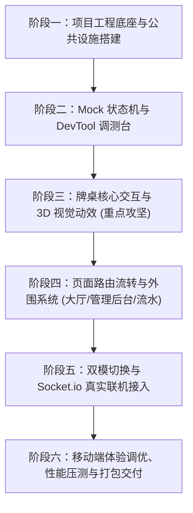

# 炸金花游戏 —— 前端专属制作计划与开发实施方案

> **文档定位**：本文档基于 [frontend_requirements.md](file:///Users/prina/Downloads/pussyGame/docs/frontend_requirements.md) 与 [api_specification.md](file:///Users/prina/Downloads/pussyGame/docs/api_specification.md)，专为前端独立开发量身定制。贯彻 **“前端先行（Mock 驱动）”** 原则，指导前端工程师在无后端环境下，高质量完成全部高保真 UI、3D 拟真翻牌、自适应 8 人环形牌桌、Web Audio 拟真音效、All-in/PK 震撼动效以及联机信令接入。

---

## 一、 系统架构与工程目录规划

项目定位于独立前端工程（后续打包输出供后端单端口托管），工程结构规范如下：

```
pussyGame/
├── client/                               # 前端独立工程根目录
│   ├── index.html                        # 移动端视口防缩放与安全区 meta
│   ├── package.json                      # 依赖管理 (React 18, Vite, Tailwind, Lucide, Zustand)
│   ├── vite.config.ts                    # 路径别名 (@) 与后端开发代理 (Proxy)
│   ├── tailwind.config.js                # 自定义金币金、暗黑赌场色盘、3D透视扩展
│   ├── src/
│   │   ├── main.tsx                      # 根应用入口
│   │   ├── App.tsx                       # 路由流转与 DevTool 挂载
│   │   ├── types/
│   │   │   └── game.ts                   # 严格复用 api_specification.md 的 TS 类型
│   │   ├── audio/
│   │   │   └── SoundManager.ts           # Web Audio API 纯代码拟真音效合成引擎
│   │   ├── store/
│   │   │   ├── useAuthStore.ts           # 用户登录凭证与个人资料状态
│   │   │   └── useGameStore.ts           # 游戏统一对局状态（支持 Mock/Socket 切换）
│   │   │   └── mock/
│   │   │       └── mockGameService.ts    # 纯前端对局模拟器（发牌/看牌/比牌/AI应答）
│   │   ├── services/
│   │   │   ├── api.ts                    # RESTful API 请求封装 (Axios/Fetch)
│   │   │   └── socket.ts                 # Socket.io 实时信令连接与事件分发
│   │   ├── hooks/
│   │   │   ├── useTableLayout.ts         # 动态 8 人第一人称三角函数桌位计算 Hook
│   │   │   ├── useTurnCountdown.ts       # 毫秒级对局倒计时本地平滑控制器
│   │   │   └── useFlyingChips.ts         # 筹码抛投与奖池飞行动画管理
│   │   ├── components/
│   │   │   ├── common/                   # 按钮、弹窗、抽屉、头像、气泡提示
│   │   │   ├── table/
│   │   │   │   ├── PokerTable.tsx        # 椭圆毛呢桌面背景与中心底池
│   │   │   │   ├── TableSeat.tsx         # 环形桌位玩家卡片 (头像/倒计时环/筹码)
│   │   │   │   ├── Card3D.tsx            # CSS 3D 拟真翻牌组件 (GPU硬件加速)
│   │   │   │   ├── ActionPanel.tsx       # 下注/加注/看牌/弃牌/比牌操作栏
│   │   │   │   ├── ChipFlyLayer.tsx      # 筹码抛物线飞行粒子层
│   │   │   │   └── ChatEmojiBubble.tsx   # 互动表情与快捷短语浮空动画
│   │   │   ├── animations/
│   │   │   │   ├── PKClashModal.tsx      # 1v1 绝密对撞火花动画弹窗
│   │   │   │   ├── AllInEpicEffect.tsx   # All-in 暗红雷电全屏震颤特效
│   │   │   │   ├── GoldStreamer.tsx      # 5000+ 高额加注金色流光粒子横幅
│   │   │   │   └── SettlementModal.tsx   # 胜利者战报与筹码吸纳结算
│   │   │   └── dev/
│   │   │       └── DevToolBar.tsx        # 左下角浮动调试台 (一键模拟所有局势)
│   │   └── views/
│   │       ├── LoginView.tsx             # 暗黑奢华登录视图
│   │       ├── LobbyView.tsx             # 房间大厅、快捷进房、创房弹窗
│   │       ├── TableView.tsx             # 核心游戏对局主视图
│   │       ├── AdminDashboard.tsx        # 房主/管理员后台 (发号/充减/审计)
│   │       └── LedgerDrawer.tsx          # 个人流水战绩抽屉
```

---

## 二、 核心技术方案与算法实现规划

### 2.1 动态 8 人自适应桌位算法 (第一人称视角锁定)
* **需求目标**：无论房间有 2 人还是 8 人，当前登录玩家永远固定在牌桌**正下方中轴操作位**，其余在座玩家均匀分布在上半椭圆。
* **数学模型与 Hook 实现 (`useTableLayout`)**：
  $$\theta_i = \frac{2\pi \times (i - myIndex)}{N} + \frac{\pi}{2}$$
  $$X_i = CenterX + RadiusX \times \cos(\theta_i)$$
  $$Y_i = CenterY + RadiusY \times \sin(\theta_i)$$
  * 当有人入座/离座时，利用 CSS `transition: all 0.5s cubic-bezier(0.4, 0, 0.2, 1)` 实现桌位丝滑平移，无突兀跳跃。

### 2.2 3D 拟真翻牌引擎 (`Card3D.tsx`)
* **硬件加速**：外层容器设置 `perspective: 1000px`，卡牌内部设置 `transform-style: preserve-3d` 与 `transition: transform 0.6s cubic-bezier(0.175, 0.885, 0.32, 1.275)`。
* **扇形微错位**：未看牌状态下，三张手牌分别设置 `-8deg`、`0deg`、`+8deg` 的倾斜与位移，形成真实手牌扇形。
* **看牌翻转**：触发看牌时，正面旋转 `rotateY(180deg)`，背面 `backface-visibility: hidden` 隐藏。翻转完成后自动显示牌型角标（如：“金花 K最大”、“豹子 AAA”）。

### 2.3 筹码抛投与飞行动画系统 (`ChipFlyLayer.tsx`)
* **抛物线轨迹计算**：获取起点玩家头像的 `getBoundingClientRect()` 与终点底池的坐标，通过贝塞尔曲线动态生成 `translate3d(dx, dy, 0) scale(...)` 关键帧动画。
* **音效联动**：筹码离手时播放轻微呼啸，落入底池瞬间触发 `playChipSound()` 陶瓷碰撞音。
* **大额高能动效**：
  - 加注 $\ge 5000$：激活 `GoldStreamer` 粒子横幅；
  - All-in 全押：激活 `AllInEpicEffect`，全屏边缘暗红闪烁 + `requestAnimationFrame` 屏幕微幅抖动 400ms。

### 2.4 绝密比牌决斗系统 (`PKClashModal.tsx`)
1. 玩家点击“比牌”，全桌存活对手头像亮起呼吸瞄准光圈；
2. 选定目标后，消耗双倍注额，全屏聚焦暗化，弹出 1v1 特写镜头；
3. 两张背面扑克牌伴随烈焰拖尾从屏幕两侧对撞，中央爆开火花（CSS 粒子 + 碰撞音效）；
4. **绝不公开底牌**：仅在负者头像上砸下暗灰色“战败”印章，手牌变灰扣倒入弃牌堆。

### 2.5 拟真音频合成系统 (`SoundManager.ts`)
* **无外部素材加载**：直接基于浏览器内置 `AudioContext` 实时合成：
  - `playDealCardSound()`：带通滤波白噪声快速扫频模拟扑克摩擦；
  - `playFlipCardSound()`：高频微共振方波模拟卡牌清脆翻折；
  - `playChipSound()`：多重正弦波衰减叠加热频模拟筹码撞击；
  - `playPKClashSound()`：过载失真 + 低频轰鸣模拟对撞；
  - `playAllInSound()`：深沉低频心跳脉冲；
  - `playWinSound()`：大三和弦清脆琶音伴随金币落袋音。
* 提供全局音量与一键静音切换功能。

### 2.6 独立 Mock 状态机与 DevToolBar
* `mockGameService.ts` 完整模拟牌桌全生命周期：
  - 支持快捷注入模拟玩家（4名虚拟玩家）；
  - 自动运行炸金花规则判定（单张、对子、顺子、金花、同花顺、豹子、235）；
  - 提供左下角悬浮 **DevTool 调测条**：
    - `[发牌]`、`[看牌]`、`[下注 +50/+5000/Allin]`、`[触发比牌]`、`[终局结算]`、`[切换人数 2/4/6/8]`；
  - 确保前端界面与动效在脱离后端时即可达到 100% 验收状态。

---

## 三、 六阶段前端制作与交付路线图



### 阶段一：项目工程底座与公共设施搭建
- [ ] 创建 `client` 工程（Vite + React 18 + TypeScript + Tailwind CSS）。
- [ ] 配置 Tailwind 自定义色彩（墨绿呢绒牌桌 `#0d381e`、筹码金、筹码蓝/紫、警示红）与 3D 透视样式。
- [ ] 完整建立 `src/types/game.ts`，精准对齐 `api_specification.md` 中的所有接口模型与信令枚举。
- [ ] 封装纯前端 `SoundManager` 音频合成类，支持发牌、翻牌、筹码、碰撞等 6 种音效及静音开关。
- [ ] 移动端全局视口与手势优化：配置 `viewport-fit=cover`、禁用双击缩放、处理 iOS 底部横条与刘海屏 `safe-area-inset`。

### 阶段二：Mock 状态机与 DevTool 调测台
- [ ] 基于 Zustand 搭建统一状态仓库 `useGameStore`，设计“Mock模式 / 网络模式”双驱动插槽。
- [ ] 编写前端轻量裁判与牌局模拟器 `mockGameService.ts`，内置 52 张洗牌、发牌、看牌状态与底池变动计算。
- [ ] 封装可折叠的浮动调测面板 `DevToolBar.tsx`，提供一键发牌、翻牌、加注、All-in 特效、比牌对撞、结算演示。

### 阶段三：牌桌核心交互与 3D 视觉动效 (重点攻坚)
- [ ] **牌桌背景与底池**：实现高保真绿色毛呢椭圆桌面、中央动态数字奖池、筹码堆叠视觉。
- [ ] **自适应桌位组件 (`TableSeat`)**：集成三角函数环形排布算法，实现当前玩家正下方居中，他人均匀环绕与入座离座平滑过渡。
- [ ] **3D 拟真翻牌 (`Card3D`)**：实现未看牌扇形发牌光效、看牌时沿 Y 轴立体翻转手感、正反面遮罩以及自动牌型角标识别。
- [ ] **筹码飞行动画 (`ChipFlyLayer`)**：实现玩家加注时的抛物线飞入底池效果，以及结算时筹码流光飞向赢家。
- [ ] **专属特效层**：
  - 5000+ 金光粒子横幅 (`GoldStreamer`)；
  - All-in 全押暗红雷电全屏震颤 (`AllInEpicEffect`)。
- [ ] **决斗与结算弹窗**：
  - 绝密 1v1 烈焰碰撞对决弹窗 (`PKClashModal`)；
  - 终局结算战报与胜利者欢呼弹窗 (`SettlementModal`)。
- [ ] **社交互动**：在头像旁呈现表情浮动气泡与漫画快捷短语对话框。

### 阶段四：页面路由流转与外围系统
- [ ] **登录视图 (`LoginView`)**：暗黑奢华微拟物风格，输入账号密码快速登录，持久化存储 Token。
- [ ] **大厅视图 (`LobbyView`)**：展示个人昵称、头像与筹码余额；提供快捷加入房间号、创建专属房间（自定义底注 10~100 与倒计时 15~60 秒）弹窗，内置规则与牌型速查面板。
- [ ] **管理员后台 (`AdminDashboard`)**：`/admin` 专属大屏，提供为新朋友开通账号、实时查看在座/在线状态、手动充减筹码、重置密码及全局审计流水日志查询。
- [ ] **个人流水账本抽屉 (`LedgerDrawer`)**：展示个人每笔筹码进出明细（底注支出、加注、胜出独揽、充减）。

### 阶段五：双模切换与 Socket.io 真实联机接入
- [ ] 封装 Axios/Fetch 请求库，集成 JWT 拦截器与统一错误提示。
- [ ] 封装 `socket.ts` 客户端连接网关，实现通过 Token 鉴权连接。
- [ ] 实现全量房间状态 `room:state` 的响应式驱动，将服务端推送的快照精确映射至 UI 渲染。
- [ ] 接入出牌倒计时组件，支持根据 `turnDeadline` 本地平滑回退与红光警示。
- [ ] 实现掉线重连自动恢复手牌与桌位快照，保证体验无缝。

### 阶段六：移动端体验调优、性能压测与打包交付
- [ ] 针对 iOS Safari 与 Android Chrome 进行全真机交互触控适配，消除误触与手势冲突。
- [ ] 针对 3D 翻牌与粒子碰撞做 GPU 合成优化（`will-change: transform`），确保 60 FPS+ 极速刷新。
- [ ] 配置 Vite 构建输出至 `client/dist`，确保资源相对路径正确，便于后端 Express 单端口静态托管。
- [ ] 输出清晰的前端使用与调试说明文档。

---

## 四、 核心组件交付标准 (验收清单)

| 模块/功能 | 核心验收标准 |
| :--- | :--- |
| **8 人第一人称自适应** | 无论在座 2~8 人，自己永远在正下方，其他人均匀分布在上方弧线，换座/进出有 0.5s 平滑补间过渡。 |
| **3D 拟真翻牌** | 扇形卡背展开，点击看牌有立体轴向翻转（180deg）光影与清脆擦牌音效，准确显示牌型标签。 |
| **下注与特效** | 筹码带抛物线飞入底池；5000+ 触发金光横幅；All-in 触发暗红雷电全屏震颤与低音心跳。 |
| **绝密比牌决斗** | 1v1 烈焰碰撞对撞动画，绝不泄露双方底牌，败者打上灰度战败印章。 |
| **音效系统** | 纯 Web Audio 振荡器合成，发牌、翻牌、筹码、碰撞无延迟播放，一键静音持久化生效。 |
| **Mock 驱动** | 点击左下角 DevTool 可独立验证所有游戏流程与弹窗动效，零后端依赖。 |
| **多端响应式** | 手机竖屏沉浸无拉伸，刘海屏/底部横条安全区适配良好，PC 宽屏居中保真展示。 |
